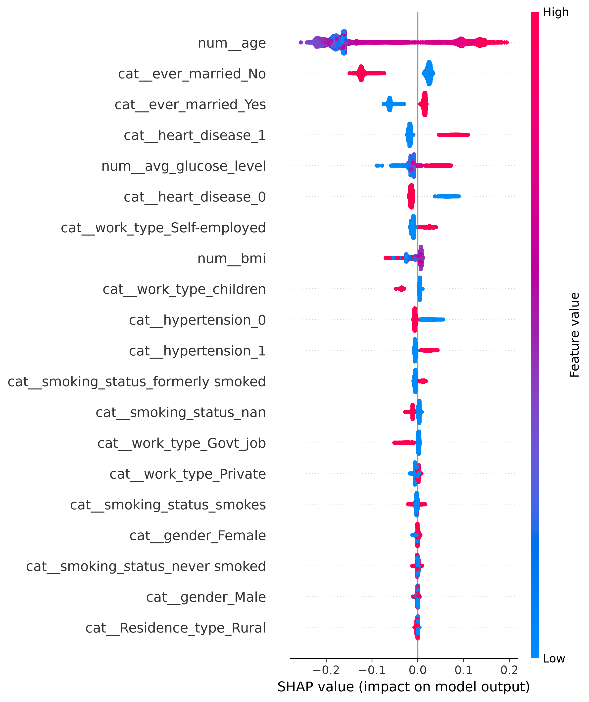

# Cerebral Stroke Prediction: A Rigorous Pipeline for Imbalanced Clinical Data

## 📌 Overview
Stroke is a leading cause of death and disability worldwide. Predicting stroke risk using machine learning is a promising area of research, but it is fraught with methodological pitfalls, particularly data leakage and severe class imbalance. 

This repository provides a **leakage-aware, reproducible machine learning pipeline** for predicting stroke risk using electronic health record data. 

## 🚀 Key Contributions
1. **Leakage-Free Preprocessing:** All imputation (`KNNImputer`), scaling, and oversampling (`SMOTE`) are performed strictly *inside* the cross-validation folds using `imblearn.pipeline.Pipeline`.
2. **Hyperparameter Optimization:** Uses `Optuna` to tune Random Forest hyperparameters, explicitly maximizing the Precision-Recall AUC (PR-AUC) rather than ROC-AUC.
3. **Reproducibility:** Fully deterministic (random seeds fixed) and designed to be run with a single command.

## 📊 Results
Evaluated on a strictly held-out 20% test set:
- **ROC-AUC:** 0.8156
- **PR-AUC:** 0.0611 *(Baseline is ~0.018)*
- **Optimal Parameters:** `n_estimators=136`, `max_depth=5`

## 🛠️ How to Reproduce
1. Clone the repository:
   ```bash
   git clone https://github.com/tahsin1017/Cerebral-Stroke-prediction.git
   cd Cerebral-Stroke-prediction
## 🔍 Interpretability (SHAP)
We use SHAP (SHapley Additive exPlanations) to understand which features drive the model's predictions. 

*Age and average glucose level are the most dominant predictors of stroke risk.*

## ⚖️ Fairness Audit
Machine learning models in healthcare can exhibit demographic bias. We evaluated our model's performance across subgroups on the test set:

### Gender Bias
| Gender | Recall (Sensitivity) | PR-AUC |
| :--- | :--- | :--- |
| Male | 82.67% | 0.0806 |
| Female | 75.61% | 0.0512 |

### Age Bias
| Age Group | Recall (Sensitivity) | PR-AUC |
| :--- | :--- | :--- |
| > 60 | 95.58% | 0.0704 |
| 40 - 60 | 42.11% | 0.0302 |
| < 40 | 0.00% | 0.0049 |

**Key Finding:** The model is highly sensitive to strokes in older populations but completely fails to detect strokes in patients under 40. This highlights the danger of deploying naive ML models in clinical settings without subgroup auditing.
